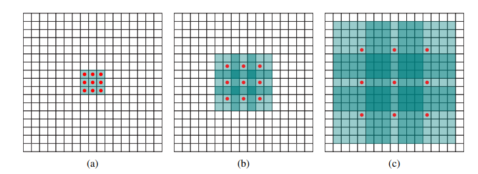
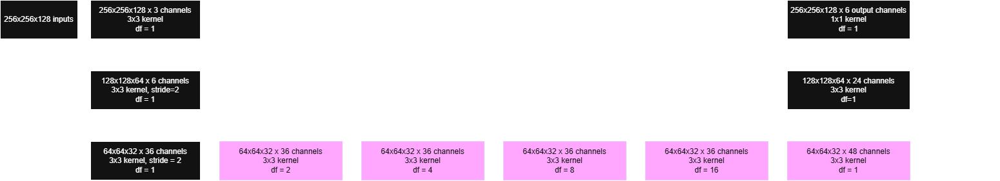
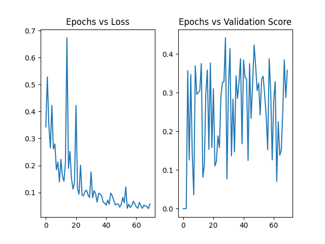
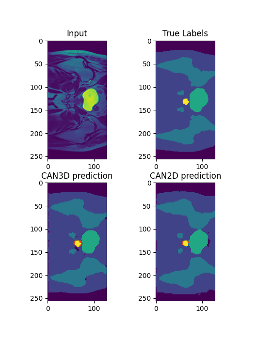
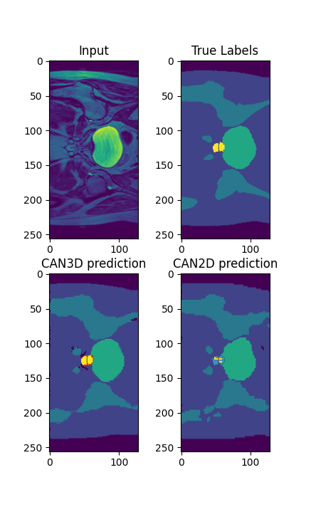
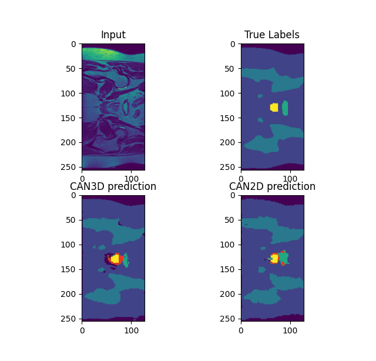
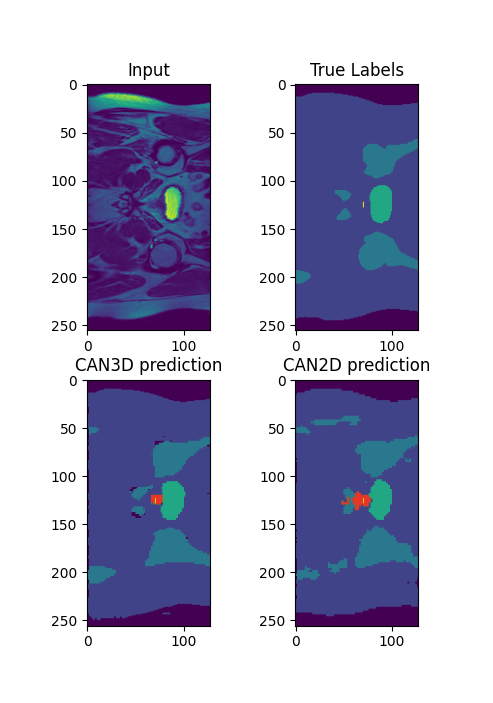
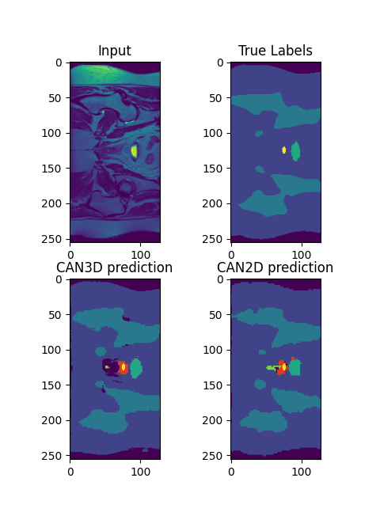
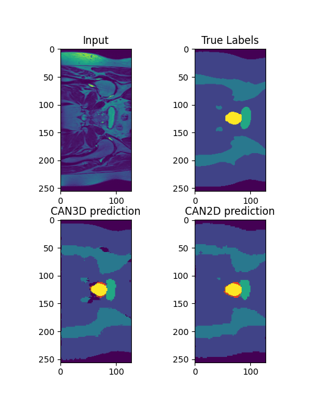

# CAN3D: Anatomical Countouring in 3D for Radiotherapy planning
The CAN3D model is a model designed for semantic image segmentation (segmenting 
an image on a pixel-by-pixel level), for 3D image volumes. The model uses dilated 
convolutions to rapidly expand its receptive field, so that it can use both local and global context
to make predictions. Compared to other models, it has lower memory and computational 
costs, which is relevent to applications which are deployed in memory and gpu limited
clinical imaging systems. We are using this model to perform segmentation
of 3D MRI images of the prostate for prostate radiotherapy planning. We are interested in whether
the 3D context provides significant benefit over baseline 2D models, ideally by using 3D 
context to avoid hazardous failures such as failure in segmenting accurately top and bottom slices 
(which are likely under-fitted due to the fact that these slices account for only a small percentage of the 2D slice data),
and avoiding leaking radiation across the thin interface of the prostate into nearby organs.

The CAN3D model works by using strided convolutions to reduce the effective size of the image, and then use dilated convolutions to rapidly expand the receptive field, and then using upsampling and a skip connection to reconstruct the full resolution. Another model with similar characteristics is the 3D UNet model, which uses iterative downsampling and upsampling in order to increase the receptive field rather than using dilated convolutions. The section of the model performing the dilated convolutions is known as the CAM (context aggregation module). Importantly, the CAN3D model relies on identity initialisation inside the CAM to train stably. Dilated convolutions have the advantage of retaining the input image resolution as you expand the receptive field, which minimises the complexity of the model considerable compared to UNet models.

The following diagram (F. Yu, 2015), illustrates how dilated convolutions can rapidly expand the receptive field (cooloured in blue), using exponentially expanding dilation factors. At each iteration a, b, c, shown below, we see the area that can possibly contribute to the value of the centre pixel (known as the receptive field of a pixel) as we apply each convolutional layer one after the other.

My final model uses the architecture below. The boxes in purple highlight the CAM using identity initialisation. 

## Feasiblity Report
### User Need, Scope & Acceptance Criteria
The intended users of our model are imaging specialists and radiologists who
would like assistance in segmentation for prostate radiotherapy planning, and in
order to save clinical countouring time. The core problem for this model is that common metrics such as the dice coefficient
can often achieve a high accuracy while failing at the boundary of the organ, where boundary leakage can cause severe side effects for patients, such as radiation induced inflammation of the bladder or rectal lining.
Additionally, models can often achieve good average accuracy while having catestrophically low accuracy on the base and apex slices (especially for 2D models), because central slices often contain easily recognisable broad regions.

Core problems that need to be solved are:
* Achieving good results on boundaries.
* Achieving uniformly good results on all slice planes (including base and apex slices).
* Fast inference for GPU limited systems.

The purpose of the prototype is to see initial results on partially trained outputs to 
see if further training will yields results worth the additional computaitonal expense, to see that
training is at least stable in early epochs, and whether the proposed architecture is likely to perform better
than simpler baselines in terms of accuracy and inference time.

I will use the following acceptance criteria:
* Segmentation of the model visually shows reasonable gains on base and apex slices compared to the 2D baseline.
* Runtime of inference occurs in under 2 seconds on a CPU.
* Peak RAM usage on inference is less than 2 GB.
* Achieving a dice coefficient of over 0.7 overall for the unseen test dataset.
* Initial graphs of training epochs show steady progress, and training and test loss converge with minimal overfitting.

### Model Choice & Course Concepts
The model I chose was stated as having HARD difficulty.

The model I have chosen is to use a CAN3D model, which works by applying 
three-dimensional dilated convolutions to rapidly expand the receptive field of 
each pixel/voxel to enable the aggregation of global context clues in the images 
to assist in segmentation, while retaining low memory requirements and inference times.

The use of full 3D images is intended to improve upon 2D slices by assisting the 
model by, in particular, identifying the boundaries and lower and upper extremal slices
using the broader three-dimensional context to better guide segmentation. This is
 likely to work since a lot of information is lost when only viewing one 2D slice at a time.

The model architecture consistents of an initial 3x3x3 convolution with 3 channels, a skip connection,
two downsampling kernels with output channels 6 and 36 respectively, a Context Aggregation Module (CAM),
which consistents of 3 dilated 3d convolution layers of increasing dilation factor (2, 4, 8, respectively) and 
a layer with a dilation of 1 increasing the number of channels to 48. This is then upscaled twice using transposed convolutions
with a stride and kernel size of 2, and concatonated to the channels of the skip connection. Each of these above convolutions contain 
what the authors refer to as "Adaptive Instance Normalisation" (which is a layer that is equal to a weighted sum of the instance norm and the identity map of the inputs) and leaky relu layers between them. Then a single 3d convolution layer outputs the logit predictions, which are then passed through softmax for final estimate probabilities.

The use of LeakyReLU is justified by the fact that it ensures that there are always gradients, and you avoid the dead-neuron problem for simple ReLU.
Adaptive Instance normalisation is used to improve training stability, improve convergence, and limit internal covariance shift (which occurs when the distribution of inputs changes as the model learns, which can cause training instability). 

(W. Dai, 2021)

The model also makes use of a unique loss function. In particular, the loss function is a combination of Dice Coefficient Loss and Focal Loss (which in the literature was originally used for dense object detection), 
which tends to perform better at segmenting boundaries than Dice Loss alone (combined, they are called Dice Squared Focal Loss, DSFL). The total loss is the weighted sum of DSFL losses of each class. The focal loss is 
similar to log loss for logistic regression, except that the loss is weighted more heavily for samples which have high uncertainty. The effect of this is to hopefully improve the predictions at difficult boundary cases.

The dataset contains 211 images in total, with many images belonging to the same patients. Since we are using a fixed model, and we don't have hyperparameters necessary to optimise, then we only need a test set (validation set is not necessary).
So, we perform an 80-20 split of training to test data. This split percentage is often a good rule of thumb, especially for reasonably small data sets such as this. When doing the test split, we make sure not to leak data between the sets by assigning samples so that samples belonging to the same patient are put into only one of the sets. If we were to mix these samples together without considering the patient level splitting, this would bias the validation accuracy estimate, since scans from the same patient are likely to be similar to previous scans, and so the model can memorise this data point rather than learning the real patterns.

### Preliminary Feasibility Evidence
The dataset contains accurately segmented MRI volumes, identifying 5 segmentation classes (Body, Bones, Bladder, Rectum, Prostate), and 0 as the background. Each volume has a dimension of exactly 256x256x128. All data contains roughly centered scans, with similar positioning and scale. There are also 211 samples, with between 1 and 7 weeks worth of scans per patient. The size of samples is too much to fit large batches into VRAM. If we use a 80-20 split for training and testing, this means that we will have 42 test cases. This means that test accuracy statistics (for example) would have a worst-case standard error of about 0.04. 

After some testing on an initial implementation, I found that on epochs of 10 samples per epoch, each epoch took around 20 seconds each. Running a small smoke test on the model, only running it for 10 epochs on 10 samples per epoch, I achieved the following images:

We can see clearly that the small test has results that are extremely inaccurate at this stage, but that it is not experience major instability or model collapse. By fine tuning the training parameters (such as class weights in the loss), and training for longer, we may find better results. However, at this state, there is a lot of progress to make.

### Risks, Budget & Fallback
The main risks are assosciated with negative health outcomes due to innacurate segmentation.

Some key technical risks include:
* Innacurate segmentation can lead to serious health consequences, so high accuracy is required.
* Only small batch sizes being able to fit into memory, which reduces training speed. This may make training better models difficult.
* Low amount of data, making generalisation more difficult. Augmentation may be possible, but limited.

Computational requirements:
* From tests, it took 100 seconds to train 5 epochs on 10 samples per epoch. This means that to train a 50 epoch model on all 211 samples, it would take roughly 5 hours.
* To simply store a single image for testing, it takes 6MB, so storing the whole database takes 1.2GB for the data.

My next planned experiment is to test with the full dataset, for a larger number of epochs, and using data augmentation with random translations. I also want to experiment with different more basic models.

A possible fallback if my planned experiment does not work, is to use the baseline model instead, assming that it has reasonable performance. 

## Dependencies and Reproducibility
Python: 3.11.17,
torch: 2.14.1 (cuda enabled),
numpy: 2.4.6,
matplotlib: 3.11.2,
monai: 1.6.1,
nibabel: 5.4.2,
scikit-learn: 1.9.1,
tqdm: 4.70.1

Splits are generated with random_state=42. Training the model should take on the order of 2 hours on a GPU. 
The model can be trained by calling `train.py`, and indicating the directory of the dataset in `dataset.py`.
All final trianing parameters and model parameters and contained in `train.py` and `modules.py`.

The final CAN3D model was trained with 100 epochs using the Adam optimiser, a learning rate of 0.01, a batch size of 8 (Note: the batches were executing one sample at a time, and then summed, since the GPU has insufficient memory to store large batches), and Dice Squared loss weights of (0.03, 0.03, 0.6, 0.3, 8.0, 18.0) respectively, and Focal Loss Weights equal to three times that in each class.

The final CAN2D model was trained on only 70 epochs, but with identical optimiser, loss, batch size, and learning rate.

## Examples and Plots
The final model gave the following output predictions.

In this diagram above, yellow indicates the prostate. The left-most image shows a particular slice of an MRI taken from a 3D volume. The middle shows the expert-labelled segmentation, and the right shows the CAN3D model segmentation. We can see that the models prediction has a few spots that are incorrectly classified as background which contribute to some of the noise of the prediction. We see that in this case, the prediction for the bone class is actually more realistic than the expert labelling, since we see in our model's prediction, a continuous bone region, while on the expert-classified segmentation, the upper left corner shows some artifacts.

While training the model, we saw the validation loss curve below:

This plots the DSF loss on the left plot, and the Dice Coefficient for the prostate class on the right plot.

We see that near the beginning, the loss was near zero, then around epoch 10, there was a massive increase, followed by a relatively quick plateau. The loss curve shows gradual decline, while the validation score seems to peak at around epoch 60, and declines negligibly after that.

Below I show a sequences of slices from the same volume, shows first the apex slice, middle slices, and base slice, as predicted by the CAN3D model. The right-most image shows false positives for the prostate class in red, and false negatives in blue.

We see that all slices except for the base slice (the last image) show very good accuracy, where for the base slice, it makes many false positive predictions for the prostate.

## Pre-Processing
The following pre-processing steps were taken during the training process:
- Cropping every image to the same size 256x256x128. (Most images were unaltered)
- Each image undergoes standardisation independently, so each image has the same range of values.
- Augmentation with random elastic deformation using the Monai library, and random flipping along the body's natural bilateral axis. This was done to improve generalisation performance.

During testing and model validation and evaluation, only cropping and standardisation was applied.

The data was split into 3 sets, training, validation, and testing, with 70-10-20 percentages respectively. 
Scikit-learn's GroupShuffleSplit was used to split on a patient-level, to avoid data-leakage.
A 20% split was chosen for testing to get a reasonably accurate measure. Since the dataset has 211 samples, this means that roughly 40 samples are used for final model evaluation, which should give a reasonable estimate of the accuracy of the model. The final splits used end up with 122-25-64 samples respectively.
The 20% test split was not used while training and tuning models, so as to not bias or overfit to it, and instead the 10% validation split was used consistently through the tuning and choice of the final model.

## Open Research Dilemma
The core investigation of this project was to determine whether incorporating true 3D volumetric continuity would reduce or eliminate hazardous boundary and slice-transition errors compared to 2D models. I make a comparison between the CAN2D model (F. Yu, 2015), and the CAN3D model (W. Dai, 2021), which both use dilated convolutions to aggregate contextual information, but where the CAN3D model uses full 3D cnvolutions, while CAN2D operates slice-wise.

### Baseline Quantitative Comparison
The final testing accuracy of the CAN3D and CAN2D model are displayed below for all classes. The prostate class is the most relevant to our investigation. Both models were trained on the same dataset using the same loss function, and compared on the same splits. The CAN2D model was run on volumes by taking the slices by height, combining them into a batch, running the batch through the model, and then recombined into the final volume.

| Model | Statistic | Background - 0 | Body - 1 | Bones - 2 | Bladder - 3 | Rectum - 4 | Prostate  - 5 (Target) | Average |
| ----- | --------- | ---------- | ---- | ----- | ------- | ------ | -------- | -- |
| CAN3D | Dice Coefficient | 0.9787 | 0.9668 | 0.8577 | 0.8227 | 0.7785 | 0.7792 | 0.8639 |
| | Intersection/Union | 0.9787| 0.9359 | 0.7515 | 0.7084 | 0.6484 | 0.6506 | 0.7789 |
| CAN2D | Dice Coefficient | 0.9330 | 0.8401 | 0.5464 | 0.3323 | 0.2536 | 0.3205 | 0.5377 |
| |Intersection/Union | 0.8748 | 0.7265 | 0.3847 | 0.2121 | 0.1537 | 0.2091 | 0.4268 |

We can see that the 3D model massively outperforms the CAN2D model on this problem. See also that CAN3D reached a Dice Coefficient greater than 0.7 across the board.

Below is the validation curve for the CAN2D model. Compared to the validation curve shown ealier for CAN3D, we see that it is much more unstable during training.

### Computational Efficiency
The following table provides the performance metrices comparing CAN3D and CAN2D. 

| Model | Metric | Value |
| ----- | ------ | ----- |
| CAN3D | Parameter Count | 224654 |
| | Training Time | 4729 (secs) |
| | Inference Time (CPU) | 4.13 (secs) |
| | Inference Time (GPU) | 0.35 (secs) |
| | Peak Memory (GPU) | 6326MB |
| CAN2D | Parameter Count | 135572 |
| | Training Time | 3310 (secs) |
| | Inference Time (CPU) | 15.23 (secs) |
| | Inference Time (GPU) | 0.32 (secs) |
| | Peak Memory (GPU) | 11166MB |

We see that the CAN3D implementation overall has much better performance metrics. We see most significantly that the CAN2D model's memory use in on-par with CAN3D. This is due to teh differences in implementation, where the CAN3D model's architecture contains two strided kernel downsampling steps to reduce memory usage, while my implementation of CAN2D uses a single maxpool-based down-sample. The CAN3D model has a higher paremeter count, and infers in a smaller time on cpu than the CAN2D model. Their GPU inference times are nearly identical. 

Depending on the implementation of CAN2D it is likely we could easily reduce the memory usage. In particular, my implementation computes the result by passing in all the slices as a large batch, while another implementation might only execute one batch at a time, and then stitch the results together at the end. 

A more thorough investigation into the code might be required to determine why the CPU inference time is much worse than the CAN3D model. Speculatively, there are some reasons this might be:
1) Because of overhead related to stacking and permuting the volume into a batch to make it fit the dimensions of the model.
2) Because CAN2D only uses one downsampling step instead of two, which means that intermediate convolutions in the CAM module can take up to 4x the memory.

### Error Case Analysis
#### Extreme Slices
To find error cases, I methodically picked random volumes, and then check slice-by-slice until I found slices with significant errors for CAN2D or CAN3D models. Below are some error cases I found.

This slice was found as an apex slice (viewing near the top of the prostate), where we see a boundary error, where the model is predicting the prostate to be larger at this slice than it actually is, causing false positives around the prostate. We see interestingly, that the CAN2D model performs better in this case. In the following images, red highlights false positive predictions, while blue highlights false negative predictions.

In this case, we see a massive false negative prediction in the CAN2D prediction near the apex slice. The CAN3D prediction is relatively accurate.

This image is an error found near the base (lower slice) of the prostate. In this case, we see catastrophic false positives in the CAN3D model. 

This image is an error around the apex of the prostate. We see that the models falsely predicted that the prostate is present at this depth (likely caused by confusion from the placement of the bladder, since the prostate sits below the bladder). The CAN3D model performs somewhat better, and the CAN2D model behaves extremely poorly.

This image is an error around the base of the prostate. We again see that the model is falsely predicting that the prostate is present where it is not.

#### Typical Middle Slice

This is a central slice taken from a typical patient (no enlarged prostate). We see false positives around the boundary of the prostate, with similar errors for both the 2D and 3D model, with the 3D model being negligibly better in this case.

#### Error Autopsy Summary
We see that the most catastrophic errors occur near the boundary of the prostate, as we usually expected. It does not seem that there is a clear advantage of the 3D model over the 2D model, since both models exhibit catastrphic failures in some cases. This is especially surprising, since the quantitative metrics for accuracy were much higher for the CAN3D model. 

For the CAN3D model, in the cases above, we do not see any false-negatives. Most errors are false-positives, meaning that the model predicted the prostate to be in a location that it was not. This indicates that the usual mode of failure for the CAN3D model is to overestimate the area of the prostate, and bleed through the boundary, rather than underestimate the size.

### Conclusions, Recommendations and Trade-Offs
#### Summary
Overall, there was a quantitative advantage for CAN3D compared to CAN2D, where the CAN3D model achieved a far greater Dice Coefficient and Intersection over Union score than the CAN2D model, despite using similar training parameters. Based on this implementation, there does not seem to be a major performance disadvantage for the CAN3D model, where both models took similar training time, inference time, and memory usage. For this implementation, CAN3D beats CAN2D overall on all performance metrics. However, from qualatative analysis, we found that the error conditions for the models are quite similar.

My stated acceptance criteria for the models stated in the Feasibility report were:
* Segmentation of the model visually shows reasonable gains on base and apex slices compared to the 2D baseline.
* Runtime of inference occurs in under 2 seconds on a CPU.
* Peak RAM usage on inference is less than 2 GB.
* Achieving a dice coefficient of over 0.7 overall for the unseen test dataset.
* Initial graphs of training epochs show steady progress, and training and test loss converge with minimal overfitting.

The first three acceptance criteria are not satisfied. From the case analysis of the errors, we find that the CAN3D model has the same modes of error as CAN2D, namely, near the boundaries. Since inference takes more than 4 seconds for CAN3D on a cpu, and takes more than 6GB of memory, the second and third criteria are also not satisfied. 

However, the last two criteria have been shown for the CAN3D model, where we see an overall Dice-coefficient of greater than 0.86, and a Dice-coefficient for the target class (prostate) of approximately 0.78.

#### Recommendations and Trade-Offs
There does not seem to be any significant negative trade-off for CAN3D for this implementation, since it performs superior to the CAN2D model, and infers faster, uses less memory, and trains in a similar amount of time. I recommend continuing to pursue true 3D techniques. I would recommend against using this model in a clinical setting without heavy huan oversight, since the CAN3D model does not fundementally solve the catestrophic errors of the 2D model.

For future investigations, I would consider attempting different implementations of the CAN2D model which may use less memory, for example, by performing downsampling to reduce memory requirements in intermediate layers, or infering one slice at a time, and combining them at the end, rather than feeding the entire volume as a batch at once. The one-slice-at-a-time optimisation would be impossible in CAN3D, since it requires full access to the entire volume during inference. This would show more clearly the difference in memory use between the two models, which would create a clearer trade-off and potential advantage for CAN2D.

In future, I would try performing more experiments involving comparing how the balance between Focal Loss and Dice Squared Loss effects boundary errors. Potentially incorporating a loss function which is more sensitive to false positives near the boundaries, and would correct for the bias of the models to overestimate rather than underestimate the prostate boundary.

## Journal and Personal Reflection
Before getting the final CAN3D model, I attempted training using several different training methods, loss functions, and slight changes to the architecture. I also made several big mistakes while implementing this model and training that I had to correct before getting good results. I also made adaptations to improve performance for the final model. 

1) The first model I trained used the CAN3D architecture suggested by the paper, with TransposedConvolutions for upsampling, and concatenating the skip connection. This model performed extremely poorly, after training for 20 minutes, it only game given a constant prediction for the 'body' class (which is the most common class).
2) I found a mistake in that implementation, where I found that the Adaptive Instance Norm layers were not the AdaIn layers seen in models like StyleGAN, but were defined as a weighted sum of an Instance Norm and an Identity. 
3) After changing the upsampling channel count to 3, and summing rather than concatenating the skip connection (because I felt that reducing the number of parameters would reduce the model complexity, so would improve training stability). This model was the one provided for the example run in the feasibility report. As seen, this produced pretty chaotic results.
4) I found a bug in the Dataset implementation which was producing blanks, fixing this made a big difference for obvious reasons.
5) I then started implementing the baseline, since I was getting errors in the 3D model I could not figure out. In retrospect, I should have done this first. 
6) After adding the correct implementation of the identity initialisation for the CAM module, I got my first decent model for CAN2D. I still had a major mistake in this implementation.
7) I finally found the big mistake I was making, where my implementation for Focal loss term in the DSF loss was incorrect. I was missing a major '* y_true' term.
8) After fixing this issue, I tried training with varying hyperparameters, but I still couldn't get a good result. I added an additional layer to the CAM module to increase the perceptive field of the model, and this produced marginally better results, but still not very good. 
9) To get a basic working CAN3D model, I tried simplifying the problem by downsampling via MaxPool, and doing a simple nearest neighbour upsample, and I removed the TransposedConvolution layers. This produced the first reasonable results of any model I had attempted to this point.
10) After adding image augmentation to training, I re-implemented the old kernel-stride-based downsampling, but used nearest-neighbour upsample layers with convolutions rather than TransposedConvolution layers. This massively improved training stability compared to previous models.
11) Then, to produce the final model, I played with the number of channels of the upsampling layers, and increased the weighting of rarer classes in the loss function (specifically, Rectum and Prostate class weights were massively increased). I kept increasing the weights of prostate until I got the final model with Dice Coefficient > 0.7 across the board. I noticed that as I increased the weights for the prostate, as expected, the background and body dice-coefficients got worse (which is a trade-off induced by the loss function weights).

I tested many other variations, but these were the main milestones.

## References
W. Dai, S. Chandra, et al. “CAN3D: Fast 3D medical image segmentation via compact context aggregation”, 2021, https://doi.org/10.1016/j.media.2022.102562.

Olaf Ronneberger, et al. "U-Net: Convolutional Networks for Biomedical Image Segmentation", 2015, https://doi.org/10.48550/arXiv.1505.04597

F. Yu and V. Koltun, “Multi-scale context aggregation by dilated convolutions”, 2015, https://doi.org/10.48550/arXiv.1511.07122 

## Artificial Intelligence Usage Disclosure
I have not directly used AI tools to help program or give ideas for any part of this project. Coincidental use of AI through Google search may have helped in debugging errors and understanding library documentation.

## Usage Instructions
* `train.py` Call this file to train the model. Modify the bottom of the script to call `train_2d` or `train_3d` as desired.
* `predict.py` Call this file to perform a number of different inference tasks. Modify the function call at the bottom to `predict_2d` or `predict_3d` to perform testing, and `make_figures` or `perform_benchmark` to produce visualisations and benchmarks.
* `modules.py` Contains the model definitions, and loss functions used. Alter as desired.
* `dataset.py` Contains functions for loading HIPMRI nifti database files. Can alter default path in here, or in `train.py`.