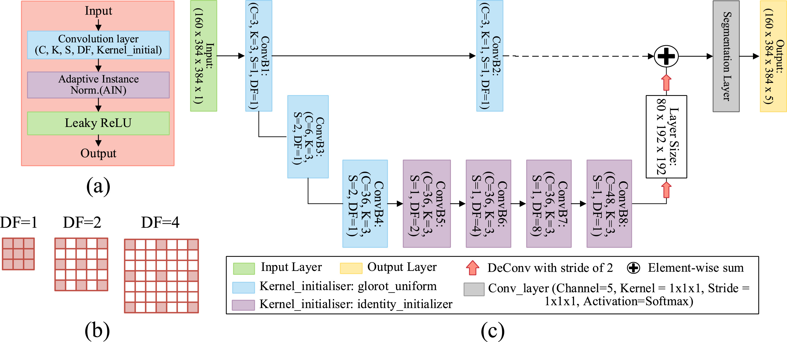
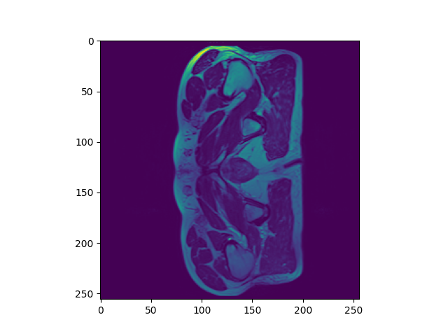
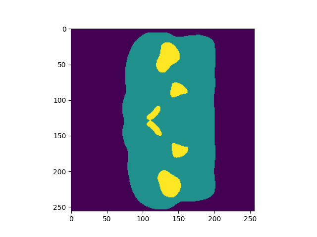
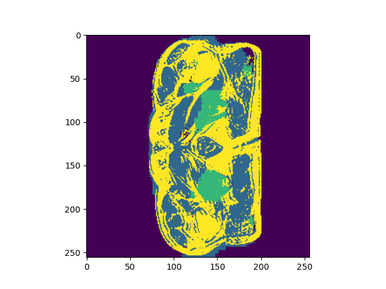

# CAN3D: Anatomical Countouring in 3D for Radiotherapy planning
The CAN3D model is a model designed for semantic image segmentation (segmenting 
an image on a pixel-by-pixel level), for 3D image volumes. The model uses dilated 
convolutions to expand its receptive field, so that it can use both local and global context
to make predictions. Compared to other models, it has lower memory and computational 
costs, which is relevent to applications which are deployed in memory and gpu limited
clinical imaging systems. We are using this model to perform real-time segmentation
of 3D MRI images of the prostate for prostate radiotherapy planning. We are interested in whether
the 3D context provides significant benefit over baseline 2D models, ideally by using 3D 
context to avoid hazardous failures such as failure in segmenting accurately top and bottom slices 
(which are likely under-fitted due to the fact that these slices account for only a small percentage of the 2D slice data),
and avoiding leaking across the thin interface of the prostate into nearby organs.

## Feasiblity Report
### User Need, Scope & Acceptance Criteria
The intended users of our model are imaging specialists and radiologists who
would like assistance in segmentation for real-time prostate radiotherapy planning, and in
order to save clinical countouring time. The core problem for this model is that common metrics such as the dice coefficient
can often achieve a high accuracy while failing at the boundary of the organ, where boundary leakage can cause severe side effects for patients, such as radiation induced inflammation of the bladder or rectal lining.
Additionally, models can often achieve good average accuracy while having catestrophically low accuracy on the base and apex slices (especially for 2D models), because central slices often contain easily recognisable broad regions.

Core problems that need to be solved are:
* Achieving good results on boundaries.
* Achieving uniformly good results on all slice planes (including base and apex slices).
* Near real-time efficiency on inference for GPU limitted systems.

The purpose of the prototype is to see initial results on partially trained outputs to 
see if further training will yields results worth the additional computaitonal expense, to see that
training is at least stable in early epochs, and whether the proposed architecture is likely to perform better
than simpler baselines in terms of accuracy and inference time.

I will use the following acceptance criteria:
* Segmentation of the prototype model visually shows reasonable gains on base and apex slices compared to the 2D baseline.
* Runtime of inference occurs in under 2 seconds on a CPU.
* Peak RAM usage on inference is less than 2 GB.
* Achieving a dice coefficient of over 0.7 overall for the unseen test dataset.
* Initial graphs of training epochs show steady progress, and training and test loss converge with minimal overfitting.

### Model Choice & Course Concepts
The model I chose was stated as having HARD difficulty.

The model I have chosen is to use a CAN3D model, which works by applying 
three-dimensional dilated convolutions to rapidly expand the receptive field of 
each pixel/voxel to enable the aggregation of global context clues in the images 
to assist in segmentation, while retaining low memory requirements and inference times.

The use of full 3D images is intended to improve upon 2D slices by assisting the 
model by, in particular, identifying the boundaries and lower and upper extremal slices
using the broader three-dimensional context to better guide segmentation. This is
 likely to work since a lot of information is lost when only viewing one 2D slice at a time.

The model architecture consistents of an initial 3x3x3 convolution with 3 channels, a skip connection,
two downsampling kernels with output channels 6 and 36 respectively, a Context Aggregation Module (CAM),
which consistents of 3 dilated 3d convolution layers of increasing dilation factor (2, 4, 8, respectively) and 
a layer with a dilation of 1 increasing the number of channels to 48. This is then upscaled twice using transposed convolutions
with a stride and kernel size of 2, and concatonated to the channels of the skip connection. Each of these above convolutions contain 
what the authors refer to as "Adaptive Instance Normalisation" (which is a layer that is equal to a weighted sum of the instance norm and the identity map of the inputs) and leaky relu layers between them. Then a single 3d convolution layer outputs the logit predictions, which are then passed through softmax for final estimate probabilities.

The use of LeakyReLU is justified by the fact that it ensures that there are always gradients, and you avoid the dead-neuron problem for simple ReLU.
Adaptive Instance normalisation is used to improve training stability, improve convergence, and limit internal covariance shift (which occurs when the distribution of inputs changes as the model learns, which can cause training instability). 

(W. Dai, 2021)

The model also makes use of a unique loss function. In particular, the loss function is a combination of Dice Coefficient Loss and Focal Loss (which in the literature was originally used for dense object detection), 
which tends to perform better at segmenting boundaries than Dice Loss alone (combined, they are called Dice Squared Focal Loss, DSFL). The total loss is the weighted sum of DSFL losses of each class. The focal loss is 
similar to log loss for logistic regression, except that the loss is weighted more heavily for samples which have high uncertainty. The effect of this is to hopefully improve the predictions at difficult boundary cases.

The dataset contains 211 images in total, with many images belonging to the same patients. Since we are using a fixed model, and we don't have hyperparameters necessary to optimise, then we only need a test set (validation set is not necessary).
So, we perform an 80-20 split of training to test data. This split percentage is often a good rule of thumb, especially for reasonably small data sets such as this. When doing the test split, we make sure not to leak data between the sets by assigning samples so that samples belonging to the same patient are put into only one of the sets. If we were to mix these samples together without considering the patient level splitting, this would bias the validation accuracy estimate, since scans from the same patient are likely to be similar to previous scans, and so the model can memorise this data point rather than learning the real patterns.

### Preliminary Feasibility Evidence
The dataset contains accurately segmented MRI volumes, identifying 5 segmentation classes (Body, Bones, Bladder, Rectum, Prostate), and 0 as the background. Each volume has a dimension of exactly 256x256x128. All data contains roughly centered scans, with similar positioning and scale. There are also 211 samples, with between 1 and 7 weeks worth of scans per patient. The size of samples is too much to fit large batches into VRAM. If we use a 80-20 split for training and testing, this means that we will have 42 test cases. This means that test accuracy statistics (for example) would have a worst-case standard error of about 0.04. 

After some testing on an initial implementation, I found that on epochs of 10 samples per epoch, each epoch took around 20 seconds each. Running a small smoke test on the model, only running it for 10 epochs on 10 samples per epoch, I achieved the following images:

We can see clearly that the small test has results that are extremely inaccurate at this stage, but that it is not experience major instability or model collapse. By fine tuning the training parameters (such as class weights in the loss), and training for longer, we may find better results. However, at this state, there is a lot of progress to make.

### Risks, Budget & Fallback
The main risks are assosciated with negative health outcomes due to innacurate segmentation.

Some key technical risks include:
* Innacurate segmentation can lead to serious health consequences, so high accuracy is required.
* Only small batch sizes being able to fit into memory, which reduces training speed. This may make training better models difficult.
* Low amount of data, making generalisation more difficult. Augmentation may be possible, but limited.

Computational requirements:
* From tests, it took 100 seconds to train 5 epochs on 10 samples per epoch. This means that to train a 50 epoch model on all 211 samples, it would take roughly 5 hours.
* To simply store a single image for testing, it takes 6MB, so storing the whole database takes 1.2GB for the data.

My next planned experiment is to test with the full dataset, for a larger number of epochs, and using data augmentation with random translations. I also want to experiment with different more basic models.

A possible fallback if my planned experiment does not work, is to use the baseline model instead, assming that it has reasonable performance. 

## References
W. Dai, S. Chandra, et al. “CAN3D: Fast 3D medical image segmentation via compact context aggregation”, 2021, https://doi.org/10.1016/j.media.2022.102562.

## Artificial Intelligence Usage Disclosure
I have not used AI tools to help program or give ideas for any part of this project.